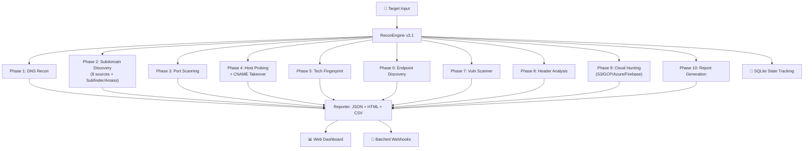

# FastRecon ⚡ v3.1

**An automated security reconnaissance & vulnerability scanning framework for bug bounty hunters, penetration testers, and security researchers.**

Enter a domain → FastRecon discovers subdomains (8 sources including Subfinder & Amass), scans ports, finds hidden endpoints, tests for vulnerabilities (XSS, SQLi, CORS, etc.), analyzes security headers, hunts misconfigured cloud buckets (S3, GCP, Azure, Firebase), detects subdomain takeovers via CNAME + fingerprint matching, tracks new subdomains across scans with a SQLite diff engine, and generates professional reports (JSON, HTML, CSV) — all in one command.

---

## 🔑 Key Features

| Capability | Details |
|---|---|
| **Subdomain Enumeration** | 8 parallel sources: crt.sh, HackerTarget, AlienVault, URLScan, RapidDNS, WebArchive + optional Subfinder & Amass CLI tools |
| **State Tracking** | SQLite-backed diff engine surfaces only NEW subdomains per scan cycle |
| **HTTP Probing** | HTTPS-first probing with status codes, page titles, server headers, and tech stack detection |
| **Cloud Asset Scanning** | Permutation-based checks against AWS S3, GCP Storage, Azure Blob, Firebase RTDB & Firebase Storage |
| **Subdomain Takeover Detection** | CNAME resolution + fingerprint matching against 20+ cloud services |
| **Vulnerability Scanning** | XSS, SQLi, CORS, Open Redirect, CRLF, Clickjacking, Host Header Injection, Directory Listing |
| **Security Headers** | A+ through F grading with individual header assessment |
| **Real-time Alerts** | Color-coded Discord & Slack webhooks with batched delivery |
| **Web Dashboard** | Built-in Flask UI with target management, scan triggering, result browsing, and data management |
| **Data Management** | Search, select, and bulk-delete subdomains; purge old scan data from the dashboard |
| **Structured Export** | Timestamped JSON, HTML, and CSV output for reporting and integration |
| **Port Scanning** | Async TCP scanner, top 20/100/1000 ports, banner grabbing, SSL cert extraction |
| **Tech Fingerprinting** | 30+ technologies: CMS, frameworks, servers, CDNs, WAFs, analytics |
| **Endpoint Discovery** | Path fuzzing (200+ paths), JS file parsing, API endpoint extraction |
| **Docker Support** | One-command containerized deployment with persistent data volumes |

---

## 📐 Architecture



---

## 📦 Installation

### Option 1: Local (pip)

```bash
git clone https://github.com/adityasinh-jadeja/fastrecon.git
cd fastrecon
pip install -r requirements.txt
```

### Option 2: Docker (Recommended)

```bash
docker-compose up --build
# Open http://localhost:5000
```

### Optional: Install Subfinder & Amass for Enhanced Discovery

FastRecon works without these tools (uses 6 built-in API sources), but they significantly increase subdomain coverage:

```bash
# Subfinder (recommended)
go install github.com/projectdiscovery/subfinder/v2/cmd/subfinder@latest

# Amass (optional, slower but thorough)
go install github.com/owasp-amass/amass/v4/...@master
```

> **Note:** If Subfinder/Amass aren't installed, FastRecon gracefully skips them with a message — no crashes, no configuration needed.

---

## 🚀 Usage

### Web UI (Recommended)

```bash
# Start the web interface
python main.py --web

# Open http://localhost:5000 in your browser
# Use tabs: Scan | Targets | History | Subdomains
```

**Dashboard features:**
- **Scan tab**: Enter a domain, select mode, watch real-time progress
- **Targets tab**: Save domains for recurring scans, one-click re-scan
- **History tab**: View all past scans, export CSV/JSON, delete/purge old data
- **Subdomains tab**: Search subdomain database, select & bulk-delete entries

### CLI — Basic Scan

```bash
python main.py -t example.com
```

### CLI — Full Options

```bash
# Quick passive recon (no active vulnerability testing)
python main.py -t example.com --mode light

# Balanced scan with HTML report
python main.py -t example.com --mode normal --report html

# Deep aggressive scan with all report formats
python main.py -t example.com --mode aggressive --report all

# Generate CSV export
python main.py -t example.com --report csv

# Skip specific phases
python main.py -t example.com --skip-ports --skip-vulns

# With webhook alerts
python main.py -t example.com \
  --discord-webhook https://discord.com/api/webhooks/YOUR_ID/YOUR_TOKEN
```

### All CLI Flags

| Flag | Default | Description |
|---|---|---|
| `-t, --target` | *required* | Target domain (e.g., `example.com`) |
| `--mode` | `normal` | Scan mode: `light`, `normal`, `aggressive` |
| `--report` | `json` | Report format: `json`, `html`, `csv`, `both`, `all` |
| `-o, --output` | `recon_results.json` | Output report file |
| `-c, --concurrency` | `50` | Max concurrent requests |
| `--skip-ports` | — | Skip port scanning |
| `--skip-vulns` | — | Skip vulnerability scanning |
| `--skip-endpoints` | — | Skip endpoint discovery |
| `--no-cloud` | — | Skip cloud storage hunting |
| `--discord-webhook` | — | Discord webhook URL |
| `--slack-webhook` | — | Slack webhook URL |
| `--wordlist` | — | Custom bucket suffix wordlist |
| `--web` | — | Launch Flask web UI |
| `--host` | `0.0.0.0` | Web UI host |
| `--port` | `5000` | Web UI port |
| `-v, --version` | — | Show version |

### Scan Modes

| Mode | Ports | Endpoints | Vuln Tests | Speed |
|---|---|---|---|---|
| **Light** | Top 20 | ~60 paths | No active tests | ⚡ Fast |
| **Normal** | Top 100 | ~150 paths | Basic injection tests | 🔍 Balanced |
| **Aggressive** | Top 1000 | ~300+ paths | Full payload set | 💥 Thorough |

---

## 💾 State Tracking

FastRecon uses a SQLite database (`data/fastrecon.db`) to track state across scan cycles:

- **Subdomain Diff Engine**: Compares each scan's subdomains against previously stored ones. Only NEW subdomains are highlighted — ideal for monitoring programs over time.
- **Scan History**: All scans are persisted with full reports, queryable from the dashboard or API.
- **Target Management**: Save targets for recurring scans with notes and last-scanned timestamps.

```bash
# First scan — all subdomains are "new"
python main.py -t example.com
# ✓ Total unique subdomains: 45 (from 8 sources)
# 🆕 New subdomains this scan: 45

# Second scan — only shows what changed
python main.py -t example.com
# ✓ Total unique subdomains: 48 (from 8 sources)
# 🆕 New subdomains this scan: 3
#   + new1.example.com
#   + new2.example.com
#   + staging.example.com
```

---

## 📊 Export Formats

| Format | Contents | CLI Flag |
|---|---|---|
| **JSON** | Full structured scan data | `--report json` |
| **HTML** | Visual report with severity grading, dark theme | `--report html` |
| **CSV** | Three files: alerts, subdomains, endpoints | `--report csv` |
| **Both** | JSON + HTML | `--report both` |
| **All** | JSON + HTML + CSV | `--report all` |

CSV files are timestamped: `example_com_20260721_120000_alerts.csv`

---

## 🐳 Docker

```bash
# Build and run with Docker Compose
docker-compose up --build

# Or build manually
docker build -t fastrecon .
docker run -p 5000:5000 -v $(pwd)/reports:/app/reports -v $(pwd)/data:/app/data fastrecon

# Run a CLI scan inside Docker
docker run -v $(pwd)/reports:/app/reports fastrecon python main.py -t example.com --mode normal

# Docker includes Subfinder for enhanced subdomain discovery
```

**Volumes:**
- `./reports:/app/reports` — Persists JSON/HTML/CSV reports
- `./data:/app/data` — Persists SQLite database (state tracking, scan history)

---

## 📁 Project Structure

```
fastrecon/
├── fastrecon/
│   ├── __init__.py              # Package init, version (3.1.0)
│   ├── config.py                # Signatures, wordlists, payloads, ports
│   ├── engine.py                # 10-phase pipeline orchestrator
│   ├── db.py                    # SQLite state tracking & diff engine
│   ├── dns_recon.py             # DNS enumeration & zone transfer
│   ├── discovery.py             # Subdomain discovery (8 sources + Subfinder/Amass)
│   ├── port_scanner.py          # Async TCP port scanner
│   ├── prober.py                # Live host probing
│   ├── fingerprint.py           # Technology & WAF detection
│   ├── endpoint_discovery.py    # Path fuzzing & JS parsing
│   ├── vuln_scanner.py          # Vulnerability checks (11 tests)
│   ├── header_analyzer.py       # Security header grading
│   ├── takeover.py              # Subdomain takeover (HTML + CNAME)
│   ├── cloud_hunter.py          # Cloud bucket scanning (S3/GCP/Azure/Firebase)
│   ├── webhooks.py              # Discord & Slack batched alerts
│   ├── reporter.py              # JSON + HTML + CSV reports
│   ├── web_ui.py                # Flask web interface + data management APIs
│   └── templates/
│       ├── index.html           # Web UI: dashboard with tabs
│       └── results.html         # Web UI: results view
├── data/                        # SQLite database (auto-created)
├── reports/                     # Generated reports (auto-created)
├── main.py                      # CLI entry point
├── requirements.txt             # Python dependencies
├── Dockerfile                   # Container image (includes Subfinder)
├── docker-compose.yml           # Docker Compose config
├── .dockerignore                # Docker build exclusions
├── .gitignore                   # Git exclusions
├── LICENSE                      # MIT License
└── README.md                    # This file
```

---

## 🔌 API Endpoints (Web UI)

| Method | Endpoint | Description |
|---|---|---|
| `POST` | `/api/scan` | Start a new scan |
| `GET` | `/api/progress` | SSE stream for scan progress |
| `GET` | `/api/results/<id>` | Get scan results (JSON) |
| `GET` | `/api/report/<id>` | Get HTML report |
| `GET` | `/api/history` | List scan history |
| `GET` | `/api/stats` | Aggregate statistics |
| `GET` | `/api/targets` | List saved targets |
| `POST` | `/api/targets` | Add a target |
| `DELETE` | `/api/targets/<id>` | Delete a target |
| `GET` | `/api/subdomains/<target>` | List subdomains (with search) |
| `DELETE` | `/api/subdomains` | Bulk delete subdomains |
| `DELETE` | `/api/scans/<id>` | Delete a scan |
| `POST` | `/api/scans/purge` | Purge old scans |
| `GET` | `/api/export/<id>/csv` | Download CSV export |
| `GET` | `/api/export/<id>/json` | Download JSON export |

---

## ⚠️ Disclaimer

> **This tool is intended for authorized educational and ethical security testing only.**
>
> You must have explicit written permission from the owner of any target system before running FastRecon against it. Unauthorized scanning of systems you do not own or have permission to test is **illegal** and may violate local, state, and federal laws including the Computer Fraud and Abuse Act (CFAA).
>
> The authors assume no liability for misuse of this tool. Use responsibly.

---

## 📄 License

MIT License — see [LICENSE](LICENSE) for details.
